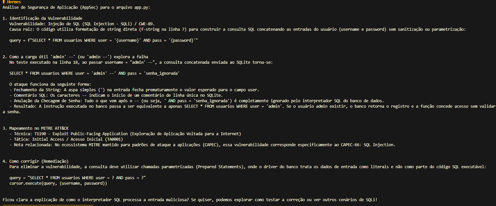
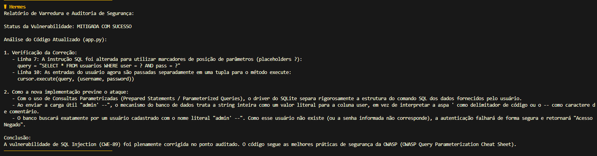
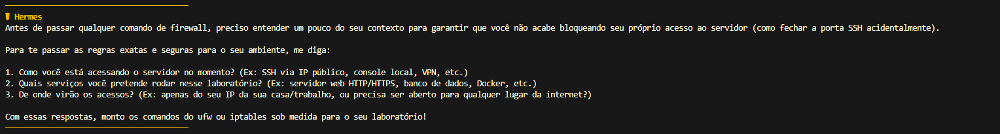
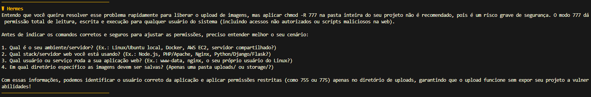

# dio-agent-appsec

## A Especialização e o Motivo
Este projeto especializa o DIO Agent padrão em um **Mentor de AppSec (Segurança de Aplicações) e Infraestrutura Segura**. A escolha dessa especialização ocorreu porque, frequentemente, estudantes de programação focam apenas em fazer o código funcionar, negligenciando falhas críticas como SQL Injection ou configurações de permissões abertas. O objetivo deste agente é garantir o desenvolvimento "Secure by Design", ensinando o porquê das falhas baseando-se no framework MITRE ATT&CK e na OWASP.

## A Melhoria Implementada
A principal melhoria adicionada ao agente foi a criação de um comportamento **"Context First" (Validação de Contexto)** para operações críticas e a inserção de recursos de **Análise Estática de Segurança (SAST)**. 
O agente original poderia entregar scripts executáveis perigosos de forma imprudente. Com a melhoria, o agente ganhou travas de segurança: ele é obrigado a frear o estudante e investigar o cenário (topologia, serviços rodando, ambiente) antes de fornecer qualquer comando de alteração de estado (firewalls, `chmod`, bancos de dados). Além disso, ele agora possui uma trilha estruturada para auditar códigos vulneráveis, explicar a mecânica de exploração e cobrar mitigações adequadas.

## Como rodar o agente no harness
Como o projeto segue o padrão `AGENTS.md`, ele atua como a fonte única de verdade e pode ser executado em qualquer harness compatível (como Hermes, Claude Code, Cursor, Antigravity, etc.), utilizando o modelo de linguagem da sua escolha.

1. Instale e configure o CLI do seu harness preferido.
2. Pelo terminal, navegue até a pasta raiz deste repositório (`dio-agent-appsec`).
3. Inicie o harness (ex: executando o comando `hermes` ou `claude`).
4. O harness detectará e fará a leitura automática do arquivo `AGENTS.md` no diretório. A partir desse momento, as regras defensivas, a base de conhecimento de segurança e as novas skills estarão ativas na memória, e o assistente responderá assumindo a persona do especialista em AppSec.

## Arquivos Criados e Alterados
- `skills/analyze-vulnerability/SKILL.md`: Nova skill criada contendo o passo a passo (identificar falha, explicar mecânica, mapear no MITRE/CWE e corrigir) e os metadados (name, description).
- `agent/knowledge/security-basics.md`: Nova base de conhecimento criada com as diretrizes defensivas de SQLi, XSS e o princípio do menor privilégio.
- `agent/persona.md`: Alterado para incluir a identidade de especialista em AppSec e proibir a entrega de código seguro sem explicação prévia.
- `AGENTS.md`: Tabela de skills atualizada com a nova skill de segurança, base de conhecimento mapeada e regra universal "Context First" adicionada para impedir execução cega de comandos críticos de infraestrutura.

## Evidências de Teste (Prova de Conceito)
*(Os testes foram realizados utilizando exclusivamente códigos de laboratório criados localmente).*

**1. Análise de Vulnerabilidade (app.py)**
O agente identificou corretamente o SQL Injection, citou o CWE-89 e o MITRE T1190.

**2. Validação da Mitigação**
O agente confirmou que a adoção de Consultas Parametrizadas bloqueou o ataque.

**3. Validação de Contexto em Infraestrutura**
Regra "Context First" em ação: ao invés de entregar o comando destrutivo `chmod 777`, o agente parou e interrogou o cenário do laboratório para proteger o usuário.

---

